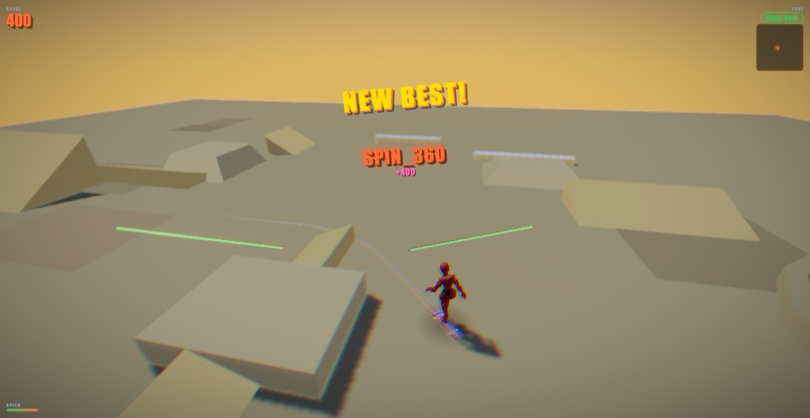
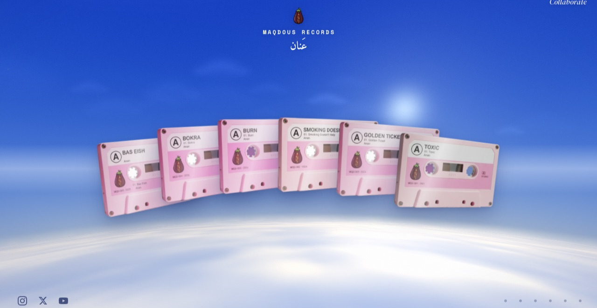
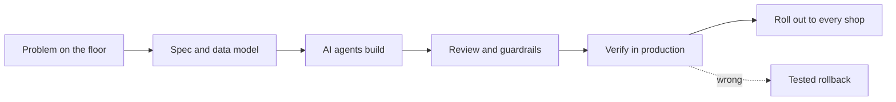

# Anan Khalidi

I started behind the bar in 2020. Six roles later I'm Head of Innovations & Partnerships at QahwaBLK, a specialty coffee chain with 30+ shops, and I build most of the software it runs on.

I don't write a spec and wait for a dev team. I design the system, AI coding agents write the code, and I check every release against production before anyone relies on it. That's how everything below got built.

## Shipped at work

| System | What it does | Result |
|---|---|---|
| **Shareeb Qahwa** loyalty app | Levels, streaks, referrals, birthday rewards and a wallet, redeemable at any till through the Odoo POS. Live on web, iOS approved by Apple. | **160,000 users** in three months |
| **Staff KPIs and incentives** | Attendance, sales, cash, stock and waste scored every month into an incentive tier, plus a staff app for counts, maintenance and skill checks. | **300 staff** scored monthly |
| **Pickup ordering app** | Pickup pre-ordering wired into the POS, kitchen screens and card payments. | Launch-ready |
| **Operations dashboard** | Cash closing, anomaly alerts, maintenance and supply chain, fed by Odoo 19 and HR data pipelines. | **30+ shops** on one screen |

I also ran Garage Week with Replit and Endeavor Jordan: a hackathon and a drink exchange where customers invented the drinks, we sold them in our branches, and the winner joined the permanent menu.

The code belongs to the company. Three more systems are written up with diagrams in **[case-studies](https://github.com/AnanK-sudo/case-studies)**: music control for every shop, blind stock counts against the ERP, and a 12,000-code coupon tracker.

## Built on my own time

<table>
<tr>
<td width="50%" valign="top">

<h3>Amman Skateboard Legend</h3>
A 3D skate game in the browser. Physics-driven riding, 30 tricks chained into combos, and three zones, one of them Old Amman rebuilt from a photo of the 7 Hills park.
  
<a href="https://anank-sudo.github.io/amman-skateboard-legend/"><b>Play it</b></a> · <a href="https://github.com/AnanK-sudo/amman-skateboard-legend">Code</a> · Three.js, cannon-es
</td>
<td width="50%" valign="top">

<h3>Maqdous Records</h3>
The site for my music. You land in the sky, and every track is a cassette you can spin through and play on Anghami, Spotify or Apple Music.
  
<a href="https://maqdous-records.com"><b>Visit</b></a> · React, Three.js, Firebase
</td>
</tr>
<tr>
<td width="50%" valign="top">
<h3><a href="https://github.com/AnanK-sudo/agent-guardrails">agent-guardrails</a></h3>
The rules my AI coding agents run under. They can't switch accounts, push or deploy without my go, and if the guard breaks it fails closed. 32 tested cases.
</td>
<td width="50%" valign="top">
<h3><a href="https://github.com/AnanK-sudo/logic-mcp">logic-mcp</a></h3>
Lets an AI agent produce a vocal inside Logic Pro, which has no scripting API. It poses as a hardware control surface over MIDI and scripts the rest through macOS accessibility. Paused at a live checkpoint.
</td>
</tr>
</table>

## How I ship

I verify by effect, not by log. Data changes ship with a rollback script I've already run. Nothing goes live on an agent's word.

## Tools

## Contact

I work in English and Arabic from Amman. Fastest way to reach me: [LinkedIn](https://www.linkedin.com/in/anan-al-khalidi) or [anan-mubarak@hotmail.com](mailto:anan-mubarak@hotmail.com).
